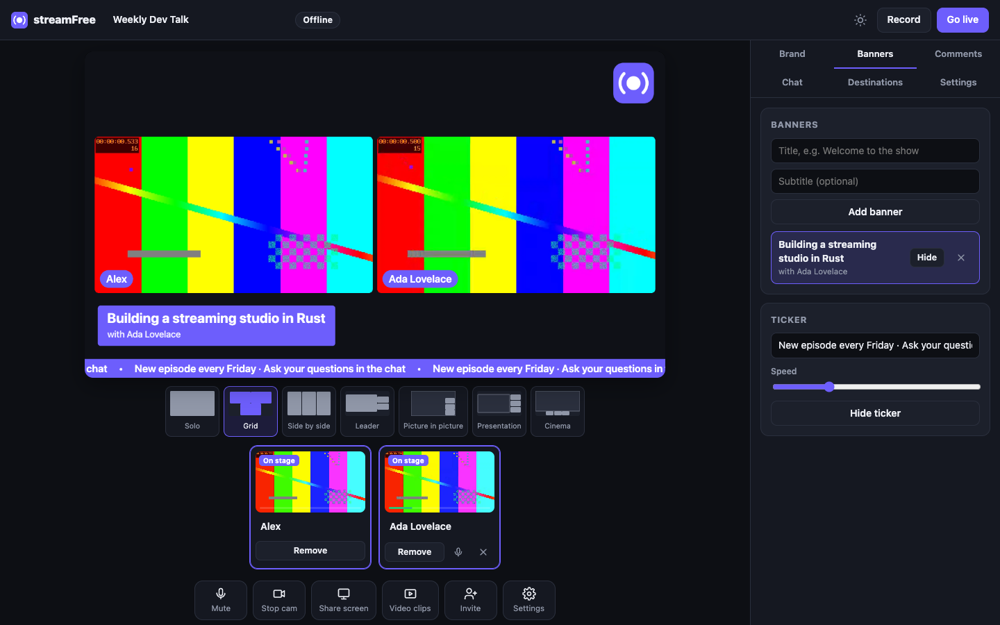

<div align="center">


# streamFree

**Uno studio di live streaming gratuito, locale e open source.**
Invita ospiti con un link, aggiungi il tuo branding e trasmetti su YouTube,
Twitch, Facebook e qualsiasi server RTMP contemporaneamente, registrando sul
tuo computer. Un solo piccolo download, nessun account, nessun watermark,
nessun limite di tempo.

[English](README.md) · **Italiano**

</div>



## Funzionalità

- **Studio nel browser** sul tuo computer: videocamera, microfono, condivisione schermo con audio, clip video.
- **Gli ospiti entrano da un link** con qualsiasi browser moderno, senza installare nulla. Aspettano nel backstage finché non li aggiungi, sentono la diretta senza eco (*mix-minus* per ospite), vedono il programma in onda e possono scriverti in privato.
- **Multistreaming** verso tutte le destinazioni RTMP/RTMPS che la tua connessione regge. Ogni destinazione si riconnette da sola e una lenta non rallenta le altre.
- **Registrazione locale** in MP4 (H.264 + AAC). Resiste ai crash: se il computer si spegne, il file resta riproducibile fino agli ultimi secondi.
- **Layout**: singolo, griglia, affiancati, leader, picture in picture, presentazione, cinema.
- **Branding**: logo, overlay a tutto schermo, sfondi a colore o immagine, targhette dei nomi nei tuoi colori.
- **Banner e ticker**: prepara i sottopancia prima della diretta e mostrali con un clic.
- **Commenti a schermo**: chat di Twitch senza login, oppure domande inserite a mano.
- **720p o 1080p a 30 o 60 fps**, codificati con l'encoder hardware del computer tramite WebCodecs.
- **Privato per scelta**: lo studio ascolta solo su `127.0.0.1`, le chiavi di stream non lasciano mai il tuo computer, nessuna telemetria.

La mappa completa delle funzionalità, comprese quelle in arrivo, è in [docs/feature-spec.md](docs/feature-spec.md).

## Installazione

**macOS e Linux**

```sh
curl -fsSL https://raw.githubusercontent.com/iamvinbas/streamFree/main/install.sh | sh
```

**Windows** (PowerShell)

```powershell
irm https://raw.githubusercontent.com/iamvinbas/streamFree/main/install.ps1 | iex
```

Oppure scarica il file per il tuo sistema da [Releases](https://github.com/iamvinbas/streamFree/releases), estrailo ed esegui `streamfree`.
Su macOS un binario scaricato dal browser viene messo in quarantena perché non è notarizzato. Sbloccalo una volta con
`xattr -d com.apple.quarantine ./streamfree`, oppure usa lo script qui sopra.

## Primi passi

1. Esegui `streamfree`: lo studio si apre nel browser.
   - Chi conduce deve usare **Chrome, Edge, Brave o un altro browser Chromium** (versione 100 o successiva).
   - Gli ospiti possono usare qualsiasi browser moderno.
2. Consenti videocamera e microfono.
3. Facoltativo: apri **Destinations** e aggiungi YouTube, Twitch o un altro server RTMP con la sua chiave di stream.
4. Premi **Record** per registrare soltanto, oppure **Go live** per trasmettere (e registrare) ovunque insieme.
5. Le registrazioni finiscono in `~/Movies/streamFree` su macOS e in `~/Videos/streamFree` su Windows e Linux.

## Invitare ospiti

I browser consentono la videocamera solo su pagine sicure (HTTPS), tranne che su `localhost`. Scegli una di queste opzioni:

| Dove sono gli ospiti? | Avvia streamFree con | Cosa fanno gli ospiti |
|---|---|---|
| Su questo computer (prove) | `streamfree` | Aprono il link di invito |
| Nella rete di casa o dell'ufficio | `streamfree --lan` | Aprono il link e accettano una volta l'avviso del certificato |
| Ovunque su internet | `streamfree --tunnel` | Aprono il link `https://….trycloudflare.com` |
| Dietro un tuo proxy HTTPS | `streamfree --public-url https://studio.example.com` | Aprono il link |

- `--tunnel` richiede [`cloudflared`](https://developers.cloudflare.com/cloudflare-one/connections/connect-networks/downloads/) installato. Crea un indirizzo HTTPS temporaneo e gratuito. Attraverso il tunnel passano solo la pagina ospite e la segnalazione; audio e video viaggiano direttamente tra i browser.
- Se alcuni ospiti non riescono a connettersi (reti aziendali o mobili restrittive), aggiungi un server TURN in **Settings → Guests → ICE servers**.

## Opzioni da riga di comando

```text
streamfree [--port 8787] [--lan] [--tunnel] [--public-url URL]
           [--data-dir DIR] [--recordings-dir DIR] [--no-open]
```

Impostazioni, destinazioni e immagini caricate stanno nella cartella dati:

- `~/Library/Application Support/streamFree` su macOS;
- `%APPDATA%\streamFree` su Windows;
- `~/.local/share/streamFree` su Linux.

## Come funziona

Il browser di chi conduce cattura, compone e codifica (WebCodecs, H.264 e AAC hardware) in un worker in background. Il binario Rust riceve il flusso codificato e fa ciò che un browser non può fare:

- lo pubblica via RTMP/RTMPS su ogni destinazione;
- scrive la registrazione MP4;
- inoltra la segnalazione WebRTC tra te e gli ospiti.

Dettagli in [docs/architecture.md](docs/architecture.md). Standard e paper alla base del progetto in [docs/references.md](docs/references.md).

## Stato e limiti

streamFree è giovane. Cosa è verificato, e come:

| Area | Come è stata testata |
|---|---|
| Registrazione, due destinazioni RTMP in contemporanea, ospiti WebRTC, sincronia audio/video | Test automatici su macOS con Google Chrome |
| Uscita RTMP | Verificata contro il server RTMP di FFmpeg |
| Connessione alla chat di Twitch | Verificata dal vivo |

Ancora da verificare:

- **L'invio alle piattaforme reali** (YouTube, Twitch, Facebook…) non è ancora stato verificato dagli autori. Segnala cosa funziona per te.
- **Condurre richiede l'encoder AAC del browser.** Verificato con Chrome su macOS. Su Windows (Chrome, Edge) dovrebbe funzionare tramite l'encoder di sistema, ma non è testato. Chrome su Linux sembra non includere un encoder AAC: su Linux streamFree funziona per gli ospiti ma non ancora per condurre, e in quel caso mostra un errore chiaro.
- **Tab in background**: lo streaming è progettato per mantenere il frame rate anche con la tab dello studio in background, ma nessun test automatico lo copre ancora.

In programma, come da [docs/feature-spec.md](docs/feature-spec.md): registrazioni multitraccia per ospite, scene, uscita verticale, chat di YouTube, sfocatura dello sfondo e sottotitoli locali.

## Compilare dai sorgenti

```sh
git clone https://github.com/iamvinbas/streamFree && cd streamFree
cargo build --release          # binario in target/release/streamfree
cargo test                     # test unitari (+ test con FFmpeg come oracolo, se installato)
cd tests/e2e && npm install && npm test   # test nel browser (servono Google Chrome e ffmpeg)
```

Serve Rust 1.88 o successivo (il minimo dichiarato dalle dipendenze; sviluppato con 1.99). Lo studio web è HTML/CSS/JavaScript semplice in `web/`, incorporato nel binario in fase di compilazione.

## Licenza

[MIT](LICENSE). streamFree è un progetto indipendente, non affiliato ad alcun servizio di streaming. I nomi delle piattaforme sono marchi dei rispettivi proprietari.
