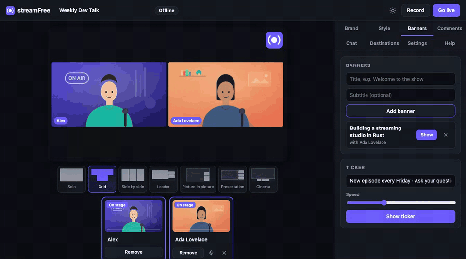

<div align="center">


# streamFree

**Lo studio di live streaming gratuito che gira sul tuo computer.**

Invita ospiti con un link, aggiungi il tuo branding, trasmetti su YouTube,
Twitch, Facebook e qualsiasi server RTMP contemporaneamente e registra in MP4.
Un'app desktop sotto i 5 MB, senza account, abbonamento né watermark.

[](https://github.com/iamvinbas/streamFree/releases/latest)
[](https://github.com/iamvinbas/streamFree/actions/workflows/ci.yml)
[](https://github.com/iamvinbas/streamFree/releases)
[](LICENSE)

**[Sito](https://iamvinbas.github.io/streamFree/)** · **[Download](#download)** · [English](README.md) · **Italiano**

</div>



## Download

| Sistema | Download | Note |
|---|---|---|
| **macOS** 11+, Apple Silicon | [streamFree-macOS-AppleSilicon.dmg](https://github.com/iamvinbas/streamFree/releases/latest/download/streamFree-macOS-AppleSilicon.dmg) | Aprilo e trascina streamFree in Applicazioni |
| **macOS** 11+, Intel | [streamFree-macOS-Intel.dmg](https://github.com/iamvinbas/streamFree/releases/latest/download/streamFree-macOS-Intel.dmg) | |
| **Windows** 10/11, 64 bit | [streamFree-Windows-Setup.exe](https://github.com/iamvinbas/streamFree/releases/latest/download/streamFree-Windows-Setup.exe) | Installer per utente, senza permessi di amministratore; [.zip portabile](https://github.com/iamvinbas/streamFree/releases/latest/download/streamfree-x86_64-pc-windows-msvc.zip) |
| **Linux** x86-64 / ARM64 | [x86-64](https://github.com/iamvinbas/streamFree/releases/latest/download/streamfree-x86_64-unknown-linux-gnu.tar.gz) · [ARM64](https://github.com/iamvinbas/streamFree/releases/latest/download/streamfree-aarch64-unknown-linux-gnu.tar.gz) | Richiede Chrome, Edge o Brave; vedi i [limiti](#stato) |

Ogni file ha il suo checksum `.sha256` nella [pagina delle release](https://github.com/iamvinbas/streamFree/releases).

**Oppure installa con un comando.** Lo script verifica il checksum SHA-256 e aggiunge l'app al sistema, senza sudo:

```sh
# macOS e Linux
curl -fsSL https://raw.githubusercontent.com/iamvinbas/streamFree/main/install.sh | sh
```

```powershell
# Windows (PowerShell)
irm https://raw.githubusercontent.com/iamvinbas/streamFree/main/install.ps1 | iex
```

**Primo avvio.** L'app non è ancora firmata da Apple o Microsoft, quindi il sistema chiede conferma una volta:

- **macOS:** clic destro sull'app e scegli **Apri**. Se macOS la blocca ancora, vai in Impostazioni di Sistema → Privacy e sicurezza → **Apri comunque**. Il comando di installazione evita questo passaggio.
- **Windows:** se SmartScreen avvisa, scegli **Ulteriori informazioni** → **Esegui comunque**.

## Cosa ottieni

- **Un'app vera.** Su macOS e Windows streamFree ha una sua finestra, un'icona nel Dock o nella barra delle applicazioni, una barra dei menu e i suoi permessi. L'interfaccia gira nel motore web del sistema (WebKit su macOS, WebView2 su Windows), come Slack o VS Code: non serve un browser. Su Linux lo studio si apre in una finestra di Chrome, Edge o Brave.
- **Ospiti con un link.** Fino a 16 ospiti entrano da qualsiasi browser moderno, senza installare nulla:
  - aspettano nel backstage finché non li porti in scena;
  - vedono il programma in onda;
  - sentono tutti tranne se stessi (*mix-minus*), quindi senza eco;
  - possono scriverti in privato.
- **Multistreaming.** Trasmetti su tutte le destinazioni RTMP/RTMPS che la tua connessione regge: YouTube, Twitch, Facebook, LinkedIn, Kick, X o un tuo server. Ogni destinazione si riconnette da sola e una lenta non rallenta le altre.
- **Registrazione a prova di crash.** L'MP4 locale (H.264 + AAC) viene scritto a frammenti: anche dopo un crash il file si riproduce fino agli ultimi secondi.
- **Strumenti per lo show:**
  - 7 layout: singolo, griglia, affiancati, leader, picture in picture, presentazione, cinema;
  - logo, overlay a tutto schermo, sfondi a colore o immagine;
  - targhette dei nomi nei tuoi colori;
  - sottopancia preparati prima della diretta e ticker scorrevole;
  - condivisione schermo con audio;
  - clip video per intro e outro.
- **Inviti integrati.** Nella finestra Invita scegli chi può entrare:
  - questo computer;
  - la tua rete locale (HTTPS);
  - chiunque su internet, con un link gratuito di Cloudflare.

  Poi condividi il link con QR code, WhatsApp, Telegram, email o un invito copiato.
- **Commenti a schermo.** Leggi la chat di Twitch senza login e metti in onda un commento con un clic, oppure inserisci domande a mano.
- **Personalizzabile:**
  - *app:* tema (automatico, scuro, chiaro), colore d'accento, italiano o inglese, dimensione del testo, densità, pannello laterale a sinistra o a destra;
  - *in onda:* cinque stili di carattere, forma e posizione delle targhette, aspetto dei banner (pieno, sfumato, contorno, vetro) e posizione, colori del ticker, spaziatura e angoli dei riquadri.
- **Aiuto integrato.** Guide passo-passo per trovare la chiave di stream su YouTube, Twitch, Facebook, LinkedIn, Kick e X. Il pulsante **Prova** controlla il server di ogni destinazione prima di andare in diretta.
- **Qualità.** 720p o 1080p a 30 o 60 fps, con l'encoder hardware del tuo computer.
- **Privato per scelta.** Lo studio ascolta solo su `127.0.0.1`. Le chiavi di stream non lasciano mai il tuo computer, e non ci sono telemetria né server di streamFree.

La mappa completa delle funzionalità, comprese quelle in arrivo, è in [docs/feature-spec.md](docs/feature-spec.md).

## Primi passi

1. **Apri streamFree** e consenti videocamera e microfono quando il sistema lo chiede.
2. **Aggiungi le destinazioni** (facoltativo): in **Destinazioni** scegli YouTube, Twitch, Facebook o un server RTMP personalizzato e incolla la chiave di stream. La guida "Dove trovo la chiave?" spiega dove trovarla.
3. **Invita gli ospiti** con il pulsante **Invita**. Scegli chi può entrare (vedi [Ospiti](#ospiti)), poi manda il link o fai inquadrare il QR code.
4. Prepara **Brand**, **Stile**, **Banner** e layout.
5. Premi **Registra** per registrare soltanto, oppure **Vai in diretta** per trasmettere su tutte le destinazioni scelte e, se vuoi, registrare insieme.
6. Chiudi la finestra per uscire. Una registrazione in corso viene prima finalizzata.

Le registrazioni finiscono in `~/Movies/streamFree` su macOS e in `~/Videos/streamFree` su Windows e Linux. La finestra di fine diretta apre la cartella.

## Ospiti

I browser consentono la videocamera solo su pagine sicure (HTTPS), quindi la finestra Invita chiede chi può entrare. streamFree ricorda la tua scelta.

| Scelta | Chi può entrare | Cosa fanno gli ospiti |
|---|---|---|
| **Questo computer** | Solo questo computer, per le prove | Aprono il link |
| **Rete locale** | I dispositivi sulla tua Wi‑Fi o rete dell'ufficio | Aprono il link `https://…` e accettano una volta l'avviso del certificato |
| **Internet** | Chiunque abbia il link | Aprono il link `https://….trycloudflare.com` |

- **I link internet** usano lo strumento gratuito di Cloudflare [`cloudflared`](https://developers.cloudflare.com/cloudflare-one/connections/connect-networks/downloads/):
  - va installato una volta: `brew install cloudflared` su macOS, `winget install --id Cloudflare.cloudflared` su Windows;
  - l'indirizzo cambia a ogni riavvio di streamFree;
  - attraverso Cloudflare passano solo la pagina ospite e la segnalazione; audio e video viaggiano direttamente tra te e gli ospiti.
- **Ospiti che non riescono a connettersi** (reti aziendali o mobili restrittive): aggiungi un server TURN in **Impostazioni → Ospiti → Server ICE**.
- **Un tuo proxy HTTPS:** avvia streamFree con `--public-url https://studio.example.com`.

## Riga di comando

Gli installer a comando aggiungono anche il comando `streamfree` (con il `.dmg` o l'`.exe`, usa il binario dentro la cartella dell'app):

```text
streamfree [--app [--browser]] [--port 8787] [--lan] [--tunnel] [--public-url URL]
           [--data-dir DIR] [--recordings-dir DIR] [--no-open]
```

| Opzione | Effetto |
|---|---|
| *(nessuna)* | Studio in una scheda del browser predefinito (consigliati Chrome, Edge o Brave); Ctrl+C per uscire |
| `--app` | La finestra di streamFree (quella che apre l'icona); chiudendola si esce |
| `--browser` | Con `--app`: una finestra di Chrome/Edge/Brave invece della WebView di sistema |
| `--lan`, `--tunnel`, `--public-url` | Sceglie all'avvio come ti raggiungono gli ospiti (la finestra Invita fa lo stesso) |

Impostazioni, destinazioni e immagini caricate stanno in:

- `~/Library/Application Support/streamFree` su macOS;
- `%APPDATA%\streamFree` su Windows;
- `~/.local/share/streamFree` su Linux.

Il log dell'app è `streamfree.log`, nella stessa cartella.

## Come funziona

```text
 browser degli ospiti ──WebRTC──▶  streamFree sul tuo computer  ──RTMP(S)──▶ YouTube · Twitch · Facebook · qualsiasi server
                                   ├─ studio (WebView di sistema)       └────▶ registrazione.mp4
                                   │   camera, schermo, ospiti → worker di composizione → H.264 + AAC (WebCodecs)
                                   └─ core Rust: invio RTMP, registratore MP4, segnalazione, impostazioni
```

- **Studio.** Cattura, compone e codifica in un worker in background con l'encoder hardware (WebCodecs).
- **Core Rust.** Fa ciò che una pagina web non può fare:
  - pubblica su ogni destinazione via RTMP/RTMPS;
  - scrive l'MP4;
  - inoltra la segnalazione WebRTC agli ospiti;
  - custodisce le chiavi di stream.
- **Dimensioni.** Tutto sta in un unico binario di circa 7 MB.

Dettagli in [docs/architecture.md](docs/architecture.md). Protocolli e paper alla base del progetto in [docs/references.md](docs/references.md).

## Stato

streamFree è giovane. Cosa è stato verificato, e come:

| Area | Verificata con |
|---|---|
| Registrazione, due destinazioni RTMP in contemporanea, sincronia audio/video | Test automatici nel browser (Chrome vero, videocamera simulata) a ogni push |
| Ospiti: tre insieme, ognuno sente tutti tranne se stesso, chat del backstage nei due sensi, rimozione di un ospite, uscita e rientro, limite di 16 ospiti, sostituzione del link di invito | Test automatici nel browser |
| Ospiti dalla rete locale (HTTPS) e da internet (tunnel Cloudflare reale) | Test automatici nel browser, eseguiti in locale (in CI manca cloudflared) |
| QR code, pulsanti di condivisione, interfaccia in italiano, ogni stringa tradotta | Test automatici nel browser |
| Uscita RTMP e file MP4 | FFmpeg come verificatore indipendente nella suite di test |
| App macOS: finestra nativa, 30 fps con la finestra ridotta a icona, audio sincronizzato | Smoke test integrato (`streamfree --smoke-test 8`) |
| App macOS che ospita un ospite (host WebKit, ospite Chrome, programma ricevuto a 15 fps) | `npm run test:native` |
| App macOS: videocamera, microfono e condivisione schermo | Test manuale |
| I server di YouTube, Twitch, Facebook (RTMPS) e Kick (RTMPS) accettano la connessione di streamFree, e una chiave sbagliata dà un errore chiaro | Pulsante **Prova** e `cargo run --example ingest_probe`, con una chiave fittizia |

Non ancora verificato:

- **Una diretta con una chiave vera.** I controlli di protocollo qui sopra passano, ma nessuna diretta reale è stata ancora fatta. Segnala cosa funziona per te.
- **Ospiti da telefono e da altri browser.** Nessun ospite è ancora entrato da un telefono in rete mobile, né da Safari o Firefox.
- **Windows.** App e installer si compilano e passano i test in CI, ma non sono ancora stati eseguiti su un PC Windows.
- **Condurre da Linux.** Chrome su Linux sembra non avere un encoder AAC, quindi su Linux streamFree potrebbe funzionare solo per gli ospiti; in quel caso mostra un errore chiaro.

In programma:

- registrazioni multitraccia per ospite;
- scene e uscita verticale;
- chat di YouTube;
- sfocatura dello sfondo;
- sottotitoli locali.

## Sviluppo

```sh
git clone https://github.com/iamvinbas/streamFree && cd streamFree
cargo build --release                       # target/release/streamfree
cargo test                                  # test unitari + test con FFmpeg come oracolo (se installato)
cd tests/e2e && npm install && npm test     # test nel browser: servono Google Chrome e ffmpeg (cloudflared per il test internet)
npm run test:native                         # macOS/Windows: l'app conduce mentre entra un ospite Chrome
./target/release/streamfree --smoke-test 8  # macOS/Windows: registra nella finestra dell'app, metà ridotta a icona
cargo run --example ingest_probe            # come rispondono i server reali a una chiave fittizia
```

Serve Rust 1.88 o successivo. Lo studio (`web/`) è HTML, CSS e JavaScript semplice, incorporato nel binario in fase di compilazione.

| Percorso | Contenuto |
|---|---|
| `src/` | Core Rust: `server.rs` (HTTP/WebSocket), `sharing.rs` (chi può entrare), `net.rs` (HTTPS in LAN, tunnel), `live.rs` (distribuzione alle destinazioni), `rtmp/`, `mp4.rs`, `flv.rs`, `desktop.rs` (finestra nativa), `app.rs`, `chat.rs`, `store.rs` |
| `web/` | Pagine dello studio e degli ospiti, worker di composizione, worklet di cattura audio, traduzioni (`i18n.js`), aiuto (`help.js`) |
| `site/` | Il sito, pubblicato su GitHub Pages a ogni push su `main` |
| `packaging/` | Icone, script per `.app` e `.dmg` macOS, installer Windows Inno Setup |
| `tests/` | Test di integrazione con FFmpeg e test end-to-end nel browser |
| `docs/` | Architettura, mappa delle funzionalità, riferimenti |

**Pubblicare una versione.** Fai push di un tag, per esempio `v0.4.0`. GitHub Actions compila per macOS (arm64, x64), Windows e Linux (x64, arm64), crea i `.dmg` e l'installer Windows e li pubblica con i checksum. I tag con un trattino (`v0.4.0-rc.1`) diventano pre-release.

## Contribuire

Issue, idee e pull request sono benvenute; vedi [CONTRIBUTING.md](CONTRIBUTING.md).
L'aiuto più utile adesso sono le prove:

- su **Windows**;
- con una **chiave di stream vera**;
- con **ospiti da telefono**.

Se streamFree ti è utile, una ⭐ aiuta altre persone a trovarlo.

## Licenza

[MIT](LICENSE). streamFree è un progetto indipendente, non affiliato ad alcun servizio di streaming. I nomi delle piattaforme sono marchi dei rispettivi proprietari.
