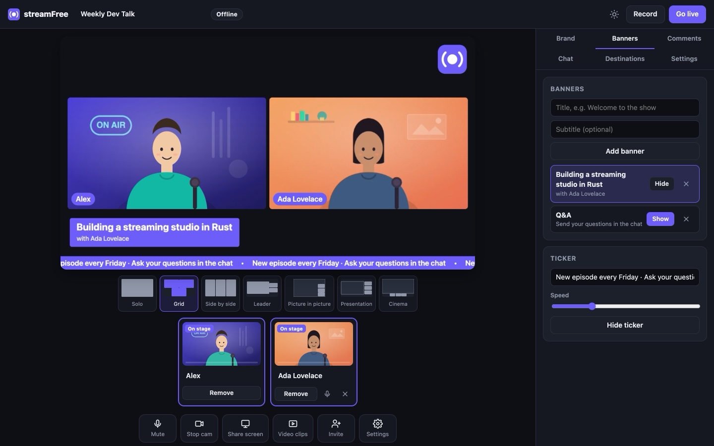

<div align="center">


# streamFree

**The free live-streaming studio that runs on your computer.**

Invite guests from a link, add your branding, stream to YouTube, Twitch, Facebook
and any RTMP server at once, and record to MP4. A desktop app under 5 MB,
with no account, no subscription and no watermark.

[](https://github.com/iamvinbas/streamFree/releases/latest)
[](https://github.com/iamvinbas/streamFree/actions/workflows/ci.yml)
[](LICENSE)

**[Website](https://iamvinbas.github.io/streamFree/)** · **[Download](#download)** · **English** · [Italiano](README.it.md)

</div>



## Download

| System | Download | Notes |
|---|---|---|
| **macOS** 11+, Apple silicon | [streamFree-macOS-AppleSilicon.dmg](https://github.com/iamvinbas/streamFree/releases/latest/download/streamFree-macOS-AppleSilicon.dmg) | Open it and drag streamFree into Applications |
| **macOS** 11+, Intel | [streamFree-macOS-Intel.dmg](https://github.com/iamvinbas/streamFree/releases/latest/download/streamFree-macOS-Intel.dmg) | |
| **Windows** 10/11, 64-bit | [streamFree-Windows-Setup.exe](https://github.com/iamvinbas/streamFree/releases/latest/download/streamFree-Windows-Setup.exe) | Per-user installer, no administrator rights; [portable .zip](https://github.com/iamvinbas/streamFree/releases/latest/download/streamfree-x86_64-pc-windows-msvc.zip) |
| **Linux** x86-64 / ARM64 | [x86-64](https://github.com/iamvinbas/streamFree/releases/latest/download/streamfree-x86_64-unknown-linux-gnu.tar.gz) · [ARM64](https://github.com/iamvinbas/streamFree/releases/latest/download/streamfree-aarch64-unknown-linux-gnu.tar.gz) | Needs Chrome, Edge or Brave; see [limits](#status) |

Every file has a `.sha256` checksum on the [releases page](https://github.com/iamvinbas/streamFree/releases).

**Or install with one command.** The script checks the SHA-256 checksum and adds the app to your system, with no sudo:

```sh
# macOS and Linux
curl -fsSL https://raw.githubusercontent.com/iamvinbas/streamFree/main/install.sh | sh
```

```powershell
# Windows (PowerShell)
irm https://raw.githubusercontent.com/iamvinbas/streamFree/main/install.ps1 | iex
```

**First launch.** The app is not signed by Apple or Microsoft yet, so the system asks once:

- **macOS:** right-click the app and choose **Open**. If macOS still blocks it, use System Settings → Privacy & Security → **Open Anyway**. The install command avoids this.
- **Windows:** if SmartScreen warns you, choose **More info** → **Run anyway**.

## What you get

- **A real app.** On macOS and Windows streamFree has its own window, Dock or taskbar icon, menu bar and permission prompts. The interface runs in the system's web engine (WebKit on macOS, WebView2 on Windows), like Slack or VS Code: no browser needed. On Linux the studio opens in a Chrome, Edge or Brave window.
- **Guests from a link.** Up to 16 guests join from any modern browser, with nothing to install:
  - they wait backstage until you bring them on stage;
  - they see the live program;
  - they hear everyone except themselves (*mix-minus*), so there is no echo;
  - they can chat with you privately.
- **Multistreaming.** Stream to as many RTMP/RTMPS destinations as your upload allows: YouTube, Twitch, Facebook, LinkedIn, Kick, X or your own server. Each destination reconnects on its own, and a slow one never holds the others back.
- **Crash-safe recording.** Local MP4 (H.264 + AAC) is written in fragments, so even after a crash the file plays up to the last second or two.
- **Show tools:**
  - 7 layouts: solo, grid, side by side, leader, picture in picture, presentation, cinema;
  - logo, full-screen overlays, colour or image backgrounds;
  - name tags in your colours;
  - lower-third banners prepared in advance, and a scrolling ticker;
  - screen sharing with its audio;
  - video clips for intros and outros.
- **Comments on screen.** Read Twitch chat without logging in and put a comment on air with one click, or type questions in yourself.
- **Quality.** 720p or 1080p at 30 or 60 fps, encoded by your computer's hardware encoder.
- **Private by design.** The studio listens on `127.0.0.1` only. Stream keys never leave your computer, and there is no telemetry and no streamFree server.

The full feature map, including what is planned, is in [docs/feature-spec.md](docs/feature-spec.md).

## Getting started

1. **Open streamFree** and allow the camera and microphone when the system asks.
2. **Add destinations** (optional): in **Destinations**, pick YouTube, Twitch, Facebook or a custom RTMP server and paste its stream key.
3. **Invite guests** with the **Invite** button (see [Guests outside your computer](#guests-outside-your-computer)).
4. Prepare your **Brand**, **Banners** and layout.
5. Press **Record** to record only, or **Go live** to stream to every selected destination, and record too if you want.
6. Close the window to quit. A running recording is finalized first.

Recordings are saved in `~/Movies/streamFree` on macOS and `~/Videos/streamFree` on Windows and Linux. The end-of-show dialog opens the folder.

## Guests outside your computer

Browsers only allow cameras on secure (HTTPS) pages, so how guests reach you depends on where they are. For now this is chosen when starting streamFree from a terminal:

| Where are your guests? | Start streamFree with | What guests do |
|---|---|---|
| On your home or office network | `streamfree --app --lan` | Open the link and accept the self-signed certificate warning once |
| Anywhere on the internet | `streamfree --app --tunnel` | Open the `https://….trycloudflare.com` link |
| Behind your own HTTPS proxy | `streamfree --app --public-url https://studio.example.com` | Open the link |

- `--tunnel` needs [`cloudflared`](https://developers.cloudflare.com/cloudflare-one/connections/connect-networks/downloads/). Only the guest page and its signaling travel through the tunnel; audio and video go directly between you and your guests.
- If some guests cannot connect (strict company or mobile networks), add a TURN server in **Settings → Guests → ICE servers**.

## Command line

The one-command installers also add the `streamfree` command (with the `.dmg` or `.exe`, run the binary inside the app folder):

```text
streamfree [--app [--browser]] [--port 8787] [--lan] [--tunnel] [--public-url URL]
           [--data-dir DIR] [--recordings-dir DIR] [--no-open]
```

| Option | Effect |
|---|---|
| *(none)* | Studio in a tab of your default browser (Chrome, Edge or Brave recommended); Ctrl+C quits |
| `--app` | streamFree's own window (what the app icon runs); closing it quits |
| `--browser` | With `--app`: a Chrome/Edge/Brave window instead of the system WebView |
| `--lan`, `--tunnel`, `--public-url` | How guests reach you (see above) |

Settings, destinations and uploaded images live in:

- `~/Library/Application Support/streamFree` on macOS;
- `%APPDATA%\streamFree` on Windows;
- `~/.local/share/streamFree` on Linux.

The app writes its log to `streamfree.log` in the same folder.

## How it works

```text
 guests' browsers ──WebRTC──▶  streamFree on your computer  ──RTMP(S)──▶ YouTube · Twitch · Facebook · any server
                               ├─ studio UI (system WebView)        └────▶ recording.mp4
                               │   camera, screen, guests → compositor worker → H.264 + AAC (WebCodecs)
                               └─ Rust core: RTMP publisher, MP4 recorder, signaling, settings
```

- **Studio.** Captures, composites and encodes in a background worker with the hardware encoder (WebCodecs).
- **Rust core.** Does what a web page cannot:
  - publishes to every destination over RTMP/RTMPS;
  - writes the MP4;
  - relays WebRTC signaling to guests;
  - keeps stream keys safe.
- **Size.** Everything ships as one binary of about 7 MB.

Details: [docs/architecture.md](docs/architecture.md). The protocols and papers behind it: [docs/references.md](docs/references.md).

## Status

streamFree is young. What has been checked, and how:

| Area | Verified by |
|---|---|
| Recording, two simultaneous RTMP destinations, WebRTC guests, audio/video sync | Automated browser tests (real Chrome, fake camera) on every push |
| RTMP output and MP4 files | FFmpeg as an independent oracle in the test suite |
| macOS app: native window, 30 fps with the window minimized, audio in sync | Built-in smoke test (`streamfree --smoke-test 8`) |
| macOS app: camera and microphone permissions | Manual test |
| Twitch chat connection, LAN HTTPS mode, macOS disk image, install script, download links | Manual and scripted checks |

Not verified yet:

- **Real platform ingest** (YouTube, Twitch, Facebook…). Please report what works for you.
- **Windows.** The app and installer build and pass the test suite in CI, but have not been run on a Windows PC yet.
- **Linux hosting.** Chrome on Linux appears to have no AAC encoder, so on Linux streamFree may only work for guests; it shows a clear error if so.
- **Screen sharing inside the macOS app**, and **`--tunnel`** end to end.

Planned:

- per-guest multi-track recordings;
- scenes and vertical output;
- YouTube chat;
- background blur;
- local captions;
- choosing LAN or tunnel from inside the app.

## Development

```sh
git clone https://github.com/iamvinbas/streamFree && cd streamFree
cargo build --release                       # target/release/streamfree
cargo test                                  # unit tests + FFmpeg-oracle tests (if ffmpeg is installed)
cd tests/e2e && npm install && npm test     # browser tests: needs Google Chrome and ffmpeg
./target/release/streamfree --smoke-test 8  # macOS/Windows: record in the app window, half minimized
```

Requires Rust 1.88 or newer. The studio (`web/`) is plain HTML, CSS and JavaScript, embedded into the binary at build time.

| Path | Contents |
|---|---|
| `src/` | Rust core: `server.rs` (HTTP/WebSocket), `live.rs` (fan-out), `rtmp/`, `mp4.rs`, `flv.rs`, `desktop.rs` (native window), `app.rs`, `chat.rs`, `net.rs`, `store.rs` |
| `web/` | Studio and guest pages, compositor worker, audio capture worklet |
| `site/` | The website, deployed to GitHub Pages on every push to `main` |
| `packaging/` | Icons, macOS `.app` and `.dmg` scripts, Windows Inno Setup installer |
| `tests/` | FFmpeg-oracle integration tests and browser end-to-end tests |
| `docs/` | Architecture, feature map, references |

**Releasing.** Push a tag such as `v0.4.0`. GitHub Actions then builds macOS (arm64, x64), Windows and Linux (x64, arm64), creates the `.dmg` files and the Windows installer, and publishes them with checksums. Tags with a hyphen (`v0.4.0-rc.1`) become pre-releases.

## License

[MIT](LICENSE). streamFree is an independent project, not affiliated with any streaming service. Platform names are trademarks of their owners.
