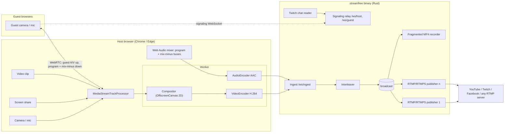

# Architecture

streamFree is one Rust binary that serves a web studio. The host's browser
does capture, compositing and encoding; the binary does everything that needs
a real network socket or a disk.



## Desktop app

On macOS and Windows, `streamfree --app` (what the app icon runs) opens
its own window with the system WebView: WKWebView on macOS, WebView2 on
Windows (`src/desktop.rs`, built on tao, wry and muda). The window has an
Edit menu so copy and paste work. Closing it unloads the page, waits until
any recording is finalized, then stops the server. On macOS the process
holds a latency-critical activity so App Nap does not throttle a live show.

WebKit differs from Chromium in two ways the studio handles:

- it reads video tracks only inside workers, so tracks are transferred to
  the compositor worker;
- AAC `decoderConfig.description` is a whole ES_Descriptor, from which the
  server extracts the AudioSpecificConfig.

Audio reaches the encoder through an AudioWorklet in both engines.

`streamfree --smoke-test 8` records for 8 s in that window, half of the
time minimized, and is used to check the WebView keeps full frame rate.

## Why this split

- **Browsers already ship the hard parts.** Camera and screen capture,
  echo cancellation, hardware H.264/AAC encoders (WebCodecs) and WebRTC with
  congestion control are all built in. Re-implementing them natively would
  mean shipping FFmpeg, libwebrtc and per-OS capture code.
- **Browsers cannot open TCP sockets or write large files.** RTMP needs raw
  TCP/TLS and recordings need the disk, so those live in Rust.
- **One small binary**, no runtime dependencies: download, run, done.

## Studio pipeline (`web/js/compositor-worker.js`)

Compositing and encoding run in a dedicated worker. Chrome throttles timers
and animation frames of hidden tabs; driving the frame clock from a worker
keeps the stream at its frame rate when the host switches tabs.

1. Every video source becomes a `ReadableStream<VideoFrame>` transferred to
   the worker; the worker keeps only the latest frame of each (older frames
   are closed at once so cameras never stall).
2. Each tick draws the scene (background, tiles, overlay, logo, banner,
   ticker, comment) on an `OffscreenCanvas`, creates a `VideoFrame` from it and
   encodes it: H.264 High profile, `avc` format, realtime latency mode (no
   B-frames), a keyframe every 2 s.
3. The program audio bus is captured by an AudioWorklet in 1024-frame
   blocks, timestamped by mapping the audio clock to wall-clock time
   (`AudioContext.getOutputTimestamp`), and encoded to AAC-LC in the worker.
   A silent constant source keeps the bus rendering when nobody is on stage.
4. Encoder warm-up: the first hardware encoder session can take seconds to
   start (measured 2.4 s for constant-bitrate H.264 and about 2 s for AAC on
   macOS), so the worker opens and closes one of each while the host prepares.

### Ingest protocol (`/ws/ingest`)

Text messages are JSON control messages:

```json
{"type":"start","record":true,"destinations":["<id>"],"name":"My show 2026-10-12 21-30"}
{"type":"video-config","width":1280,"height":720,"framerate":30,"bitrate":4500000,"description":[1,100,0,31,...]}
{"type":"audio-config","sampleRate":48000,"channels":2,"bitrate":160000,"description":[17,144]}
{"type":"stop"}
```

`description` is the `avcC` record (video) or `AudioSpecificConfig` (audio)
that WebCodecs returns. Binary messages carry one encoded chunk:

| Bytes | Field |
|---|---|
| 0 | kind: 2 = video, 4 = audio |
| 1 | flags: bit 0 = keyframe |
| 2–9 | presentation time in µs, big-endian `i64` |
| 10– | chunk payload (length-prefixed NAL units, or a raw AAC frame) |

The server answers with `started`, then a `status` message every second
(per-destination state, bitrate, dropped packets, recording size), and
`stopped` with a summary when the broadcast ends.

## Media core (Rust)

- **Interleaver** (`src/media.rs`): merges audio and video by timestamp with
  a 300 ms hold. The stream starts at the first video keyframe; audio
  captured before it is held and only the part that precedes the keyframe is
  dropped. Timestamps only need to increase within a track and are kept at
  least 1 ms apart (FLV has millisecond resolution).
- **Fan-out** (`src/live.rs`): a broadcast channel with one receiver per
  output. A slow output lags, skips to the next keyframe and catches up; it
  never blocks the others. Each destination reconnects with exponential
  backoff (1 s to 10 s).
- **RTMP** (`src/rtmp/`): simple handshake, 4096-byte chunks with type-0
  headers and extended timestamps, `connect` → `releaseStream`/`FCPublish` →
  `createStream` → `publish`, `@setDataFrame onMetaData`, AVC/AAC sequence
  headers, ping responses and acknowledgements. RTMPS uses rustls with the
  Mozilla root store.
- **Recorder** (`src/mp4.rs`): fragmented MP4. Each fragment starts at a
  keyframe and is flushed to disk, so a crash leaves a playable file up to the
  last fragment; on a clean stop the total duration is patched into `mehd`.

## Guests

- Star topology: each guest has one `RTCPeerConnection` with the host. The
  host offers two send-receive transceivers: video (a 640×360, 15 fps
  return feed of the program) and audio (that guest's mix-minus); the guest
  answers with its camera and microphone on the same transceivers.
- The Rust server only relays signaling messages between the host and guests;
  guests cannot address each other.
- Cameras require a secure context, so guests need HTTPS unless they are on
  `localhost`. The Invite window sets the **sharing mode** (`src/sharing.rs`),
  which can change while streamFree runs and is remembered in the settings:
  - *This computer*: only `http://localhost`.
  - *Local network*: an extra HTTPS listener on port + 1 with a self-signed
    certificate made on first use (`src/net.rs`), stopped when the mode changes.
  - *Internet*: a Cloudflare quick tunnel (`cloudflared`), started in the
    background; the studio is notified when the public address is ready, if it
    fails, or if the tunnel stops later. cloudflared is looked up in PATH and in
    the usual Homebrew and Windows install folders, because apps started from
    Finder or the Start menu do not inherit the shell's PATH.
  `--lan`, `--tunnel` and `--public-url` (own reverse proxy) override the mode
  for one run. The invite link is also served as a QR code (`/api/invite/qr.svg`).
- **Test** in Destinations connects to the server and runs the RTMP `connect`
  command without publishing (`Publisher::check`), which catches wrong server
  addresses. Platforms check the stream key only at `publish`; they reject a
  wrong key by closing the connection, which streamFree reports as a refused
  stream with a hint to check the key.

## Security model

- The server binds `127.0.0.1` by default. `--lan` adds an HTTPS listener on
  all interfaces; `--tunnel` exposes the same server through Cloudflare.
- The **host token** (in the studio URL, stored in `settings.json`) is
  required by every API and the ingest/host WebSockets; it is compared in
  constant time. Pages send `Referrer-Policy: no-referrer` so it does not leak.
- The **invite token** only lets a browser load the guest page and join the
  signaling room. Resetting it invalidates old links.
- Stream keys never leave the process: the API returns only whether a key is
  set and its last four characters. `settings.json` is written atomically
  with mode 0600.

## Testing

- Unit tests for every encoder/parser (`cargo test`).
- `tests/ffmpeg_oracle.rs`: FFmpeg encodes real H.264/AAC; streamFree records
  and publishes it; ffprobe and a full FFmpeg decode check the output.
- `tests/e2e/run.mjs`: real Chrome with a fake camera drives the studio:
  recording, two simultaneous RTMP destinations (FFmpeg as the server), a
  WebRTC guest going on stage, and audio/video span checks for lip sync.
